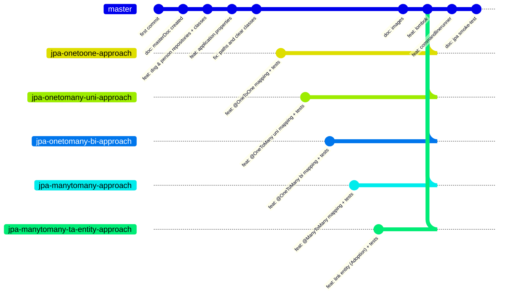

# PersonDog — Master Document v1

## Goal

Sandbox project to **practice JPA entity relationships** in a real Spring Boot setup.

The domain is intentionally minimal so the focus stays on mapping:

- **`Person`**: `id`, `name`, `age`
- **`Dog`**: `id`, `name`, `breed`, `age`

Stack:

- **Java 21**, **Spring Boot 4.1.2**
- **Spring Data JPA** + **H2** (in-memory, H2 console enabled)
- **Lombok** for boilerplate
- **JUnit 5** via `spring-boot-starter-data-jpa-test`

Base entities and repositories (`PersonRepository`, `DogRepository`) live on `master` with **no relationship mapped** — the clean baseline.

## The 5 approaches — one branch per strategy

Each JPA relationship variant lives on its own git branch so the approaches can be compared in isolation:

| Branch | Mapping | What it demonstrates |
|---|---|---|
| `jpa-onetoone-approach` | `@OneToOne` | One `Person` linked to one `Dog` (FK on one side, `mappedBy` / shared-PK variants) |
| `jpa-onetomany-uni-approach` | `@OneToMany` unidirectional | `Person` holds `List<Dog>`; `Dog` knows nothing. FK column vs join table trade-offs |
| `jpa-onetomany-bi-approach` | `@OneToMany` / `@ManyToOne` bidirectional | Owning side on `Dog` (`@ManyToOne`), inverse `mappedBy` collection on `Person` |
| `jpa-manytomany-approach` | `@ManyToMany` | Persons and dogs linked through an auto-generated join table |
| `jpa-manytomany-ta-entity-approach` | Many-to-many **as a third entity** | Join table promoted to a real entity (e.g. `Adoption`) carrying extra attributes (date, fee, ...) — implemented as two `@ManyToOne` links |

### Branch topology

All five approach branches fork from the same commit on `master` (`fix: paths and clear classes`) and grow their own mapping + test commits independently:



> The `feat: lombok` commit exists on every branch today; the `... mapping + tests` commits are the target work each branch will carry.

Checkout an approach:

```bash
git checkout jpa-onetomany-bi-approach
```

Back to the clean baseline:

```bash
git checkout master
```

## Testing the 5 approaches with JUnit

Each branch ships its own JUnit 5 test suite. Tests are sliced with **`@DataJpaTest`** so only the JPA layer + H2 boot — fast and focused.

Every approach is verified against the same test matrix:

- **Schema mapping** — expected FK column / join table exists, correct cardinality
- **Persist & read** — save entities from the owning side, reload via repository, assert the association survives the round-trip
- **Cascade behavior** — `CascadeType.PERSIST/MERGE/REMOVE` propagates (or intentionally does not)
- **Orphan removal / delete semantics** — what happens when a `Person` or a `Dog` is deleted
- **Fetching** — `LAZY` vs `EAGER`, `LazyInitializationException`, N+1 select observations
- **Bidirectional sync helpers** (bi / many-to-many branches) — e.g. `addDog()` keeps both sides consistent
- **`equals`/`hashCode`/`toString` pitfalls** — Lombok + JPA recursion traps on bidirectional graphs

`master` already contains a smoke test (`PersondogApplicationTests.contextLoads`).

Run all tests for the checked-out approach:

```bash
cd persondog
./mvnw test
```

Run a single test class:

```bash
./mvnw test -Dtest=PersonDogOneToManyBiTest
```

## Workflow summary

1. `git checkout <approach-branch>`
2. Inspect the mappings in `Person.java` / `Dog.java` (+ the extra link entity on the ta-entity branch)
3. `./mvnw test` — green tests document the expected JPA behavior
4. Inspect the generated schema via the H2 console or with `spring.jpa.show-sql=true`
5. Compare branches to consolidate the differences between approaches
